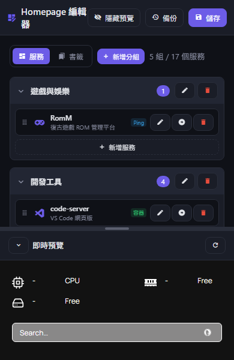

# HomePageCMS

Homepage 的設定編輯器：把 Homepage 的服務、書籤與儀表板外觀變成看得到、填得出的表單。左邊改、右邊即時預覽，每次存檔前自動備份一份，改錯也不怕。



## 功能總覽

- 雙欄介面：左側表單編輯，右側直接載入你的 Homepage 即時預覽；中間分割線可拖曳、預覽可折疊。
- 服務與書籤編輯：分組管理、拖曳排序、跨分組移動；服務可掛狀態小工具（Docker 容器、ICMP Ping、HTTP API），也能指定 Docker 主機、排序權重與 Kubernetes 目標。
- 首頁外觀：主題、配色、背景圖與濾鏡、卡片與區塊樣式、字型全部表單化；內建 23 條色階，每條可從種子色各自調色。
- 自動備份與還原：每次存檔留一份時間戳快照，介面裡一個按鈕還原。
- 存檔不傷原檔：只寫回你改過的欄位，YAML 裡其他欄位原樣保留。
- 多語系與配色：內建繁中、簡中、日文、英文與七套配色，都可以自己加。
- 存取保護：一道共用密碼鎖住整個編輯器。
- 一鍵升級：有新版時頂欄升級鈕亮起，按一下就更新完成。

## 部署

兩種跑法，改的是同一批設定檔，也可以同時跑。兩邊同時存同一份檔時，後存的一方會收到衝突提示，重新整理再存即可，不會蓋掉對方的東西。

| | 本地版 | Docker 版 |
| --- | --- | --- |
| 需要什麼 | Node.js 18 以上 | Docker |
| 怎麼跑 | `npm start` 或雙擊 `start-editor.bat` | `docker compose up -d` |
| 適合誰 | 沒有 Docker、在自己的電腦上弄 | 放伺服器或 NAS 長期跑 |

### 本地版

1. 安裝 Node.js 18 以上。不想從 Git 裝的話，直接到「發行頁面」下載最新的 zip 檔，解開即是完整專案：https://github.com/ainlee/HomePageCMS/releases
2. 在專案目錄（或解開的資料夾）執行：
   ```bash
   npm install
   npm start
   ```

   Windows 也可以直接雙擊 `start-editor.bat`：以 `0.0.0.0:3899` 啟動（方便區網內的裝置連進來），並自動開啟瀏覽器。
3. 開啟 <http://localhost:3456>（用 bat 的是 `http://<主機IP>:3899`）。

要讓編輯器去改 NAS 上 Homepage 的設定，把設定檔路徑指到 NAS 的共用資料夾即可：首次開啟時在設定視窗填，或寫在 `start-editor.local.bat`（不進版控）。

### Docker 版

兩個容器：`homepage-cms`（主程式）與 `homepage-cms-updater`（更新器）。更新器持有 git 複製並發布程式碼快照，所以有了新版，介面的升級鈕就能自己更新，不需要手動重建映像。

步驟：

1. 在要放編輯器的機器上取得程式碼：

   ```bash
   git clone https://github.com/ainlee/HomePageCMS.git
   cd HomePageCMS
   ```

2. 把 [compose.example.yml](compose.example.yml) 複製成 `docker-compose.yml`（與專案同一資料夾，映像要從這裡建置），填上自己機器的值。一定要改的：

   | 欄位 | 填什麼 |
   | --- | --- |
   | `ports` | 對外的位址與埠，例如 `192.168.x.x:3457:3456` |
   | `HOMEPAGE_CONFIG_DIR`（volumes 內的來源路徑） | Homepage 設定目錄的完整路徑（`services.yaml` 所在資料夾），並在裡面先建一個空的 `cms/` 子資料夾，放編輯器的設定與備份 |
   | `HOMEPAGE_CMS_REVALIDATE_URL` | 儀表板的公開網址；存檔後拿它通知 Homepage 重讀設定 |
   | `HOMEPAGE_PREVIEW_URL` | 儀表板的公開網址；右側預覽要載入的目標 |

   其他欄位保持範本原值就能跑；私有倉庫才需要改 `UPDATE_REPO_URL`。

3. 啟動：

   ```bash
   docker compose up -d
   ```

   首次啟動會自動建置映像，接著更新器複製程式碼、發布第一份快照（幾分鐘）。期間主容器停在「等待」是正常現象，完成後會自動重啟；卡太久就 `docker restart homepage-cms`。

4. 完成。往後有新版時，頂欄的升級鈕（雲端圖示）會亮起呼吸燈，按一下即更新完畢、頁面自動重刷；Homepage 本身的設定與備份完全不碰。

**變體**：

- 同一份 compose：把兩支服務放進 Homepage 那支 compose 檔（同一張 docker 網路），`HOMEPAGE_CMS_REVALIDATE_URL` 改填服務名 `http://homepage:3000` 即可；代價是兩邊綁在同一張卡片、不能獨立升級。
- 不要升級鈕：刪掉 `homepage-cms-updater` 服務、`HOMEPAGE_CMS_UPDATE_PROXY` 那行與 `./updates/releases:/app:ro` 掛載，程式碼改回燒進映像，升級就要手動重建映像。

**對外開放**：在 Homepage 的 tunnel／反向代理上加一條 `/cms` 路徑規則指到編輯器的 host 埠，路徑要原樣保留、不要剝掉（編輯器自己認得 `/cms` 前綴）。`https://你的網域/cms/` 就是編輯器，根路徑照舊是 Homepage。

### 環境變數

進階設定都用環境變數（Docker 裡寫在 compose 的 `environment`），不寫在程式碼裡。完整清單與註解見 [compose.example.yml](compose.example.yml)，常用者：

| 變數 | 預設值 | 說明 |
| --- | --- | --- |
| `HOST` | `127.0.0.1` | 監聽位址；Docker 內固定 `0.0.0.0` |
| `PORT` | `3456` | 連接埠 |
| `HOMEPAGE_CONFIG_PATH` | `<專案>/config` | Homepage 設定檔目錄 |
| `HOMEPAGE_BACKUP_PATH` | `<專案>/backups` | 備份目錄 |
| `HOMEPAGE_CMS_SETTINGS` | `<專案>/cms-settings.yaml` | 編輯器自身設定檔 |
| `HOMEPAGE_PREVIEW_URL` | 無 | 預覽目標網址 |
| `HOMEPAGE_CMS_BASE_PATH` | 無（掛在根路徑） | 掛在子路徑時填，例如 `/cms` |
| `HOMEPAGE_CMS_REVALIDATE_URL` | 無 | 存檔後通知 Homepage 重讀的網址 |
| `HOMEPAGE_CMS_UPDATE_PROXY` | 無 | 升級端點轉發到更新器的位址；Docker 佈署才有 |
| `HOMEPAGE_CMS_PASSWORD` | 無 | 存取密碼；建議改用介面的存取保護 |

同一組設定也能在介面的齒輪視窗裡改，寫進編輯器設定檔。優先序：路徑與連接埠以環境變數為準，預覽網址與監聽位址以設定檔為準——每個欄位下方都會顯示目前生效的值與來源。

## 使用

### 第一次使用

首次開啟會自動跳出設定視窗：把預覽網址填成你的 Homepage 網址、設定檔路徑指到 Homepage 的設定資料夾，存檔後視窗就不再出現；之後按齒輪圖示隨時可以重開。

### 改服務與書籤

- 左側「服務」「書籤」分頁：點分組標題折疊或展開；群組上的「＋」新增分組、項目旁的「＋」新增項目。
- 項目的對話框欄位跟 Homepage 的 YAML 一致（名稱、連結、縮寫、說明、圖示、狀態小工具、容器、Kubernetes 目標等），改完右側立刻看到結果。
- 拖曳行左邊的手柄排序，或按「移動」跨分組。
- 按頂欄「儲存」才真正寫檔：存檔前自動備份、存檔後通知 Homepage 重讀，預覽馬上更新。

### 改儀表板外觀

「首頁外觀」分頁，存檔後預覽立刻更新：

- 配色：選內建色階，或「未設定」跟隨 Homepage 預設。
- 主題與樣式：主題、卡片透明、標題樣式、卡片與區塊樣式、圖示樣式。
- 背景：圖片網址，以及模糊、飽和、亮度、透明度。
- 字型：內建字型、本機字型名稱，或字型來源網址（`.css` 樣式表或 `.woff2` 等字型檔皆可）。
- 種子色：每條配色一個種子色，調動後整組色階跟著走；也可以直接在自訂 CSS 區寫樣式。

### 備份與還原

每次存檔在備份目錄（預設 `backups/`）留下一份 `services-<時間戳>.yaml` 或 `settings-<時間戳>.yaml`。頂欄的備份圖示開快照清單，選一個還原；還原前會先把目前檔案再留一份，所以還原本身也可逆。

### 語言與配色方案

- 頂欄的語言圖示切換介面語言（內建繁中、簡中、日、英）。
- 頂欄的調色盤圖示開配色清單：套用、編輯、複製、匯出、匯入。
- 自己加一個 INI 檔到 `locales/` 或 `themes/` 目錄，介面就會多出選項，不用改程式；配色檔以「匯出」現成的一份當範本改最省事。

### 存取保護

齒輪視窗開「存取保護」並填密碼後，存取編輯器都要帶密碼。密碼以 scrypt 雜湊存進編輯器設定檔，不存明文，容器重建也還在。編輯器要對區網或對外開放時，先開這道鎖。

### 升級

每次開啟頁面會自動檢查有沒有新版：

- 本地版：跟 GitHub 遠端比對，有新版時升級鈕亮起；按下後自動拉新碼、裝依賴、以新行程接棒，瀏覽器自動重整理。
- Docker 版：由更新器容器完成拉碼、發布快照、重啟主容器，頁面自動重刷。

沒有 git、離線或沒有新版時，按鈕保持鎖定——亮了才代表真的有新版本。

### 設定檔格式

編輯器讀寫的就是 Homepage 原本的 YAML，手改與表單改可以混用。欄位說明見 [Homepage 官方文件](https://gethomepage.dev/configs/services/)。如果檔案在你編輯期間被其他程式改過，存檔會被拒絕並提示重新載入，不會蓋掉。

## 要注意的事

- 綁 `0.0.0.0` 代表任何連得到這台機器的人都能改你的 Homepage。預設只綁 `127.0.0.1`；要讓區網裝置連進來才開放，並同時開啟存取保護。
- 監聽位址與連接埠在介面上改完，要重新啟動才生效，介面會標示。
- 遇到空白頁或奇怪的錯誤，先按 Ctrl+F5 強制重新整理。
- 儀表板若掛在快取代理（CDN）後，`/api/config/custom.css` 會被快取數小時，改完「自訂 CSS」可能暫時看不到；以 Cloudflare 為例，在 Cache Rules 加一條對該路徑「不快取」的規則。

## 開發

行為規格在 `openspec/specs/`，開發慣例見 [AGENTS.md](AGENTS.md)。

```bash
npm test    # 版面測試，需要本機有 Chrome 且編輯器正在執行
```

## 授權

本專案採 **MIT 授權**，詳見 [LICENSE](LICENSE)：可以自由使用、修改、複製與商用，唯一條件是保留授權聲明。軟體「如實提供」，不附任何明示或暗示的保證。

主要第三方元件：

| 元件 | 授權 |
| --- | --- |
| [Express](https://expressjs.com/) | MIT |
| [js-yaml](https://github.com/nodeca/js-yaml) | MIT |
| [Vue 3](https://vuejs.org/) | MIT |
| [Material Design Icons](https://pictogrammers.com/library/mdi/) | Apache-2.0 |
