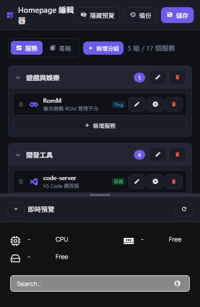

# HomePageCMS

Homepage 的設定編輯器：左側表單、右側即時預覽，存檔前自動備份。寫回的就是 Homepage 原生 YAML，沒建模的欄位原樣保留。



## 功能

- 服務與書籤：分組、拖曳排序、跨組移動、圖示與說明。
- 狀態追蹤：Docker 容器、ICMP Ping、網站監測、Kubernetes、Proxmox，五種可同時設定。
- 小工具：一個服務可掛多組 widget，用按鈕或拖曳把手排序；這個順序會寫進 `services.yaml`，直接反映在首頁。
- 首頁外觀：配色、主題、背景、字型、自訂 CSS。
- 自動備份與還原、存取密碼、一鍵升級。
- 繁中／簡中／日文／英文介面，七套配色；語系與配色都能自己加檔案擴充。

1.2.0 新增 Kubernetes 與 Proxmox 追蹤、小工具排序，並移除卡片上會擠壓版面的狀態標籤。

## 快速開始

```bash
npm install
npm start          # http://localhost:3456
```

Windows 可直接雙擊 `start-editor.bat`：以 `0.0.0.0:3899` 啟動並開啟瀏覽器。第一次開啟填預覽網址與 Homepage 設定目錄即可。

## Docker

複製 [compose.example.yml](compose.example.yml) 為 `docker-compose.yml`，改連接埠、Homepage 設定目錄與兩個網址，再啟動：

```bash
docker compose up -d
```

`homepage-cms` 是主程式，`homepage-cms-updater` 持有 git 複製；有新版本時按頂欄升級鈕，更新器會發布新快照並重啟主容器。

## 設定

| 變數 | 預設 | 用途 |
| --- | --- | --- |
| `PORT` | `3456` | 連接埠 |
| `HOST` | `127.0.0.1` | 監聽位址 |
| `HOMEPAGE_CONFIG_PATH` | `config/` | Homepage 設定目錄 |
| `HOMEPAGE_BACKUP_PATH` | `backups/` | 備份目錄 |
| `HOMEPAGE_CMS_SETTINGS` | `cms-settings.yaml` | 編輯器自身設定檔 |
| `HOMEPAGE_PREVIEW_URL` | 無 | 右側預覽網址 |
| `HOMEPAGE_CMS_BASE_PATH` | 無 | 掛在子路徑時填，例如 `/cms` |
| `HOMEPAGE_CMS_UPDATE_PROXY` | 無 | Docker 佈署的升級轉發 |

同一組設定也能在介面齒輪裡改；每個欄位下方會顯示目前生效的值與來源。

## 開發

```bash
npm test    # 需要 Chrome，且編輯器正在執行（APP_URL 可覆寫）
```

行為規格在 `openspec/specs/`，開發慣例見 [AGENTS.md](AGENTS.md)。

## 授權

MIT，詳見 [LICENSE](LICENSE)。
